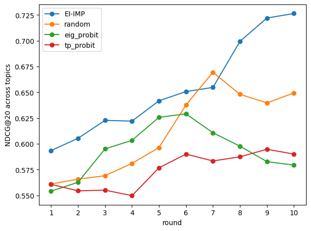

# Personalising LLMs with Few Labels via Bayesian DPO

This repository implements **Bayesian DPO**, a method for personalising large language models (LLMs) using only a small number of human preference labels.

We adapt a Bayesian optimisation framework for [Interactive Text Ranking with Bayesian Optimisation](https://arxiv.org/pdf/1911.10183) to **DPO-trained LLMs** by replacing Gaussian-process preference models with Bayesian LoRA uncertainty approximations. We evaluate three **Bayesian approximations** **(MC Dropout (MCD), Laplace, and SWAG)** and compare them against a non-Bayesian baseline. 

At the current state, MCD performs the best performance in our experiments.

---

**This project investigates**:

> Can we personalise an LLM to an individual user from only a small number of pairwise preference labels?

Our approach combines:
- Bayesian active selection of response pairs: we estimate uncertainty over candidate utilities and query the user on comparisons that are expected to be maximally informative (MCD, Laplace and SWAG).
- Efficient preference learning via DPO while training only LoRA parameters.

---

## Bayesian DPO

We adapt the Bayesian optimisation framework from [Interactive Text Ranking with Bayesian Optimisation](https://arxiv.org/pdf/1911.10183) to LLMs trained with **Direct Preference Optimisation (DPO)**.

### GPPL setting
They used a Gaussian process and did per-topic optimisation

### Our setting (Bayesian DPO)
- We replace the Gaussian process in GPPL with a Bayesian LoRA surrogate built on a DPO-trained LLM.

---

## Data

We use a topic-based summarisation dataset (**DUC 2004**) from [the DUC 2004 benchmark](https://duc.nist.gov/duc2004/).

The dataset contains:
- 50 topics, each consisting of a cluster of multiple related news articles.
- There are 4 human-written reference summaries per topic. We used this for evaluation and anchor selection.

We concatenate all documents within each DUC 2004 topic into a single source text and generate a mixed candidate pool of summaries. This aims to reflect real-world variation in summary quality and style (good/bad). Each candidate summary is constrained to around 100 words.

For each topic, we construct three types of candidates:
- Good extractive summaries: sentence-level extraction that preserves the original document order, producing coherent summaries without truncating sentences.
- Bad extractive summaries: extraction with shuffled sentence order and occasional abrupt truncation (word-level), reducing coherence and completeness
- Abstractive summaries: generated by a Llama instruction-tuned model, producing concise paraphrased summaries.

The reference summaries are not used for training the preference model, but are used for approximate full pairwise ranking via comparison against a fixed anchor set.

The DUC 2004 dataset does **not** provide preference labels. We could recover a full ranking over candidate summaries by asking an LLM judge to compare every pair, but this quickly becomes computationally infeasible. So, we used fixed anchor to reduce time. This approach avoids judging all candidate pairs while still producing a meaningful relative ranking signal.

- We select a small set of **anchors** (we use M = 32).
- For each candidate summary, we estimate a relevance/quality score as its **win-rate against the anchors**.

### How we choose anchors (why references help)

Anchor selection matters. If anchors are sampled uniformly at random, they may over-represent only the extreme tails (very strong or very weak summaries), which can make comparisons less informative and rankings less stable.

To ensure anchors are representative, we select anchors to **cover the candidate-quality distribution** by using **ROUGE-L**:

- When reference summaries are available, we compute a rough quality proxy for each candidate using **ROUGE-L** against the four human references.
- We then select anchors **stratified across the ROUGE-L score distribution** (e.g., bottom / middle / top regions). This ensures coverage of low-quality, medium-quality, and high-quality candidates in our anchor reference.

P.S. **Reference summaries are never used as supervision for preference training**. They are only used to pick anchors that cover the distribution

---

## Simulated User (LLM Judge)

Our method requires pairwise preference labels (A/B comparisons). Since the dataset (DUC 2004) does not include such labels, we use a **simulated user** in the form of an **LLM judge** to generate preference comparisons reproducibly.

Recent work suggests that LLM evaluators can act as strong oracles for preference-style judgements:

- Prior work suggests that LLM-based evaluators can be competitive with traditional automatic metrics (Chen et al., 2023).
- For summarisation in particular, *LLM-as-a-judge* style evaluations have been shown to correlate strongly with humans. In the DPO setting, (Rafailov et al., 2023) report that GPT-4 judgements when appropriately prompted-align well with human preferences.
- Muldrew et al. (2024) reported that GPT-4 vs human agreement is often comparable to (or higher than) **inter-annotator agreement** on the same summarisation comparisons.

### Judge model

We generate pairwise preference labels using:

- **Judge**: `meta-llama/Llama-3.2-3B-Instruct`  ([https://huggingface.co/meta-llama/Llama-3.2-3B-Instruct](https://huggingface.co/meta-llama/Llama-3.2-3B-Instruct))

### Prompting protocol
  
We adapt the judge prompt format from: Muldrew et al. (2024):  [Active Preference Learning for Large Language Models](https://arxiv.org/pdf/2402.08114)

The judge is prompted to compare **Summary A vs Summary B** for the same source post and output a structured decision in the form:

- `Preferred: A` or `Preferred: B`
- plus a short one-sentence justification

  
## Models

### Baseline: GPPL (Simpson et al., 2020) 

We reuse the GPPL implementation from: [Simpson et al. (2020)](https://github.com/UKPLab/tacl2020-interactive-ranking)

---

## Our Method: Bayesian DPO with LoRA

We replace the GP preference model (as used in GPPL-style methods) with a **DPO-trained, LoRA-adapted LLM** that acts as the utility surrogate:

- **Base model:** a `Qwen/Qwen2.5-0.5B` causal LLM ([https://huggingface.co/Qwen/Qwen2.5-0.5B](https://huggingface.co/Qwen/Qwen2.5-0.5B))
- **Adaptation:** LoRA (trainable adapters; base weights frozen)
- **Preference objective:** Direct Preference Optimisation (DPO)

#### Bayesian modelling of the surrogate

We support multiple Bayesian approximations over the LoRA-adapted policy. In our experiments, **MCD**, **Laplace** and **SWAG**

**MC Dropout (the best)**
1. Train a MAP LoRA policy using DPO
2. Enable dropout at inference time and draw multiple stochastic forward passes
3. Estimate a posterior over candidate utilities from Monte Carlo samples
4. Select the next comparison using Bayesian acquisition functions

**Laplace**
1. Train a MAP LoRA policy using DPO
2. Estimate curvature over LoRA parameters using **K-FAC**
3. Construct a **Laplace posterior** over LoRA parameters (diagonal or diagonal + low-rank, depending on config)
4. Propagate parameter uncertainty to candidate utility predictions via linearization
5. Select queries using Bayesian acquisition functions

**SWAG**
1. Train the LoRA policy using DPO while periodically collecting LoRA snapshots
2. Fit a SWAG posterior (mean + diagonal variance + low-rank subspace)
3. Sample LoRA parameters to obtain a posterior over candidate utilities
4. Select queries using Bayesian acquisition functions

--- 
# Acquisition function 
Similar to Simpson et al. 2020 ([https://arxiv.org/pdf/1911.10183](https://arxiv.org/pdf/1911.10183))

--- 
# Active learning loop (common to all Bayesian modes)

At each round, we do these
1. Score candidates for the current topic using the current policy
2. Use the chosen Bayesian approximation to estimate uncertainty over utilities
3. Select an informative pair of candidates via an acquisition function
4. Obtain a preference label (simulated user aka LLM-judge)
5. Update the LoRA policy with DPO on the accumulated preference pairs

--- 
# Evaluation
- NDCG@20

  
   
  <em>Figure 1: Bayesian DPO pipeline (MCD).</em>

  

